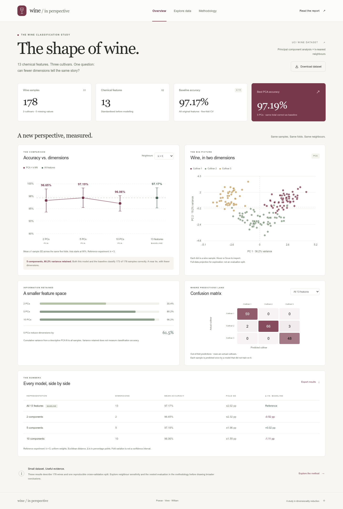

# Wine / in perspective

How does k-nearest neighbours classification change when PCA replaces the original chemical measurements? This project answers the question in [the proposal](project_proposal) with reproducible experiments, a complete paper, and an interactive dashboard.



## View the dashboard

No installation, API key, or internet connection is needed to view the committed results. From the repository root:

```bash
python3 -m http.server 8000 --bind 127.0.0.1
```

Open **http://localhost:8000/dashboard/**. Serve the whole repository so the dashboard can load `results/analysis.json`, download the data, and open the paper. Opening the HTML directly with `file://` will block its data request in most browsers.

The dashboard includes model comparisons, a neighbour-count sensitivity view, an interactive PCA projection, explained variance, out-of-fold confusion matrices, and a searchable data explorer. Everything runs locally in the browser.

## Main finding

With five neighbours and the same stratified five-fold partition:

| Representation | Dimensions | Mean accuracy | Fold SD | Correct out-of-fold |
| :--- | ---: | ---: | ---: | ---: |
| Standardised original features | 13 | 97.17% | 2.02 pp | 173 / 178 |
| PCA | 2 | 96.65% | 2.32 pp | 172 / 178 |
| PCA | 5 | 97.19% | 1.96 pp | 173 / 178 |
| PCA | 10 | 96.06% | 1.55 pp | 171 / 178 |

Five components preserve the baseline's pooled accuracy while reducing the representation from 13 dimensions to 5. Its **0.016 percentage-point** advantage in mean fold accuracy is a near tie: the models make the same number of correct predictions, and the folds have slightly different sizes. These results do not establish that PCA improves generalisation. Fold SD describes variability; it is not a confidence interval.

## Reproduce the project

Python **3.10** was used for the committed results. Dependencies are pinned in `requirements.txt`.

```bash
python3 -m venv .venv
source .venv/bin/activate
python -m pip install -r requirements.txt
python -m src.analysis
python -m pytest -q
```

The analysis command loads scikit-learn's bundled UCI Wine copy, exports the raw data, and regenerates all JSON, CSV tables, and figures. The dataset is bundled with scikit-learn, so running the experiments needs no further download once dependencies are installed. `make analyze`, `make test`, and `make serve` are equivalent shortcuts.

## What is included

| Location | Contents |
| :--- | :--- |
| [Dashboard](dashboard/index.html) | Static HTML, CSS, and JavaScript; responsive and usable offline through a local server |
| [Complete paper](docs/report.md) | Research question, methods, measured results, interpretation, limitations, and references |
| [Formatted paper](docs/report.html) · [PDF](docs/report.pdf) | Browser and print editions of the complete paper |
| [Early draft](docs/early_draft.md) | Acquired data, size and shape, working baseline, and feasibility assessment |
| [Paper outline](docs/paper_outline.md) | Section-by-section outline required by the draft guidelines |
| [Analysis](src/analysis.py) | Data preparation, matched evaluation, sensitivity study, nested tuning, and figure generation |
| [Data](data/) | All 178 samples, 13 measurements, class labels, and provenance |
| [Results](results/) | Dashboard JSON, model comparison tables, fold-level outputs, predictions, and figures |
| [Tests](tests/) | Data integrity, evaluation, preprocessing, and exported-result checks |

The original [early draft guidelines](early_draft_guidlines) and [project proposal](project_proposal) are preserved. All proposed work is completed together; the original division of responsibilities does not constrain the implementation.

## Evaluation choices

- The main comparison fixes **k = 5**, uniform neighbour weights, Euclidean distance, and **five shuffled stratified folds with seed 42**. Every representation uses the same splits.
- `StandardScaler` and optional PCA are fitted inside each training-fold pipeline. PCA uses the full SVD solver without whitening. Validation rows never influence fitted transformations.
- Mean accuracy and sample SD are calculated over the five folds. Pooled out-of-fold accuracy weights each sample equally. Confusion matrices use one held-out prediction per sample.
- The neighbour-count sweep is exploratory. A separate nested cross-validation experiment selects k using inner training folds and reports outer-fold performance, avoiding reuse of tuning scores as evaluation results.
- The PCA projection, loadings, correlations, and explained variance fitted on all 178 samples are **descriptive**. They are separate from the fold-specific transformations used for classification.

This is a small historical dataset with one fixed evaluation partition and no external validation. Cultivar labels are anonymous classes, not named grape varieties or wine-quality ratings.

## Data source and licence

Aeberhard, S. & Forina, M. (1992). *Wine* [Dataset]. UCI Machine Learning Repository. [doi:10.24432/C5PC7J](https://doi.org/10.24432/C5PC7J). The data are licensed under [CC BY 4.0](https://creativecommons.org/licenses/by/4.0/). See [data/README.md](data/README.md) for changes and provenance. The original UCI download was checked against scikit-learn's copy: all measurements and class labels match after converting scikit-learn's labels from 0–2 to 1–3.

Method references: [scikit-learn's leakage guidance](https://scikit-learn.org/stable/common_pitfalls.html), [nested cross-validation](https://scikit-learn.org/stable/auto_examples/model_selection/plot_nested_cross_validation_iris.html), and [the Wine loader](https://scikit-learn.org/stable/modules/generated/sklearn.datasets.load_wine.html).

## Browser checks

Node.js 18 or newer is needed only for the optional browser checks:

```bash
npm ci
npx playwright install chromium
npm run test:dashboard
```

The check starts a temporary local server and tests results against the exported JSON, sensitivity controls, all confusion matrices, class toggles, keyboard tooltips, filtering and pagination, report/download links, mobile containment, and the missing-data error state. It saves desktop and mobile screenshots in the ignored `test-results/` directory. Set `DASHBOARD_URL` to test an already running server, or `CHROMIUM_EXECUTABLE_PATH` to use an existing Chromium installation.

GitHub Actions reproduces the scientific results and runs the browser checks on each push and pull request. After regeneration, `python3 scripts/check_reproducibility.py` compares the data and numerical results to the committed reference with a tolerance of 1e-10, allowing a different Python patch version.

The paper's source is `docs/report.md`. To refresh its formatted HTML after editing:

```bash
python -m pip install -r requirements-docs.txt
python scripts/render_report.py
```

The HTML includes a print stylesheet. Chromium's print dialog can save it as a PDF. For an automated export after installing the browser tools above:

```bash
npm run report:pdf
```
