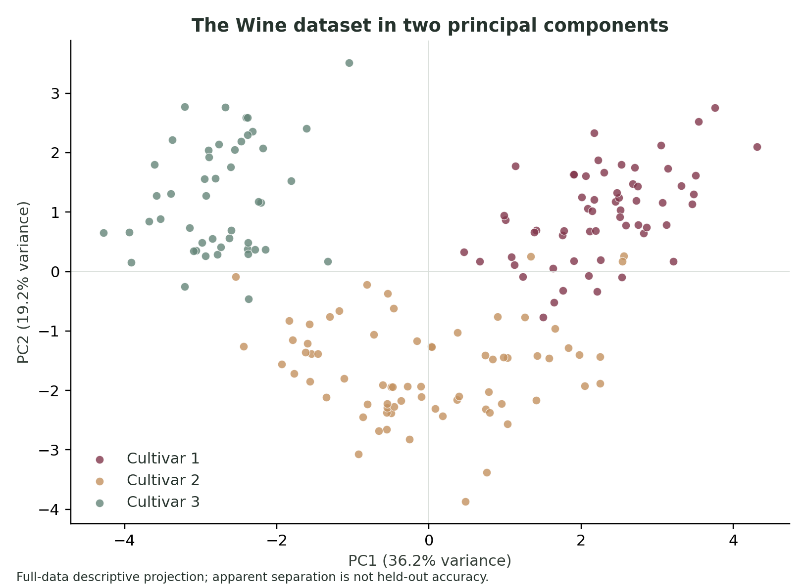
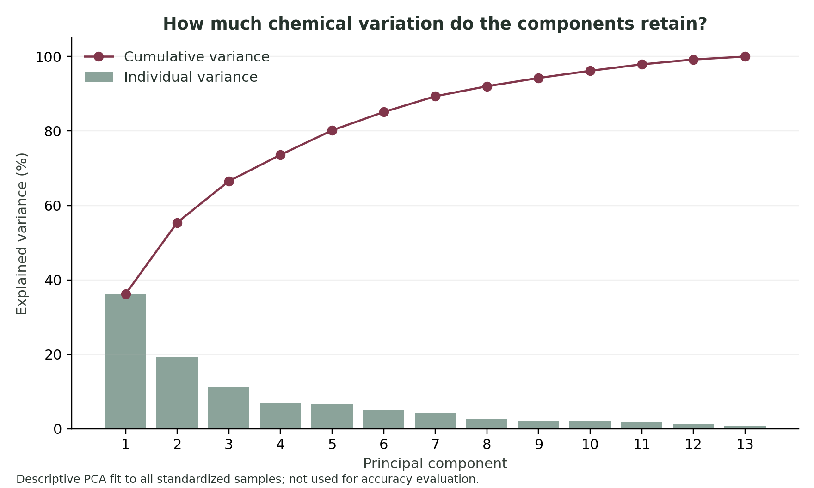
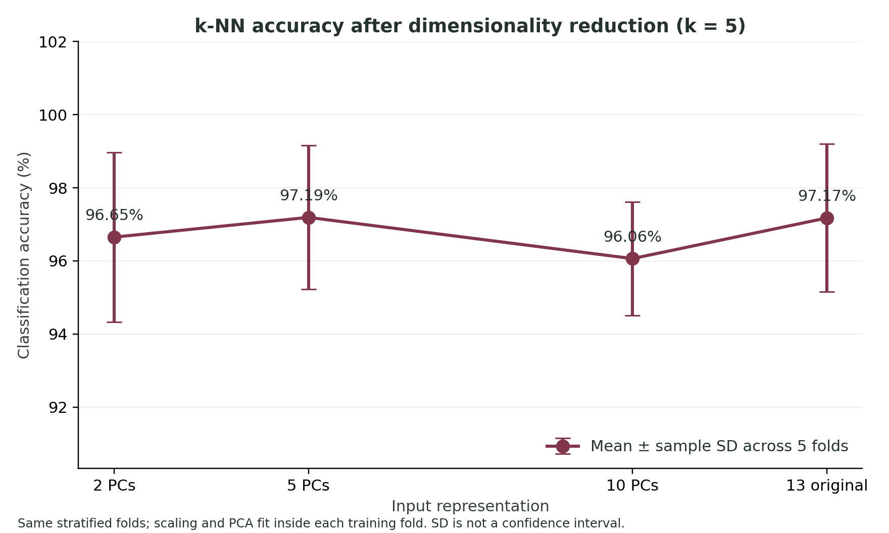
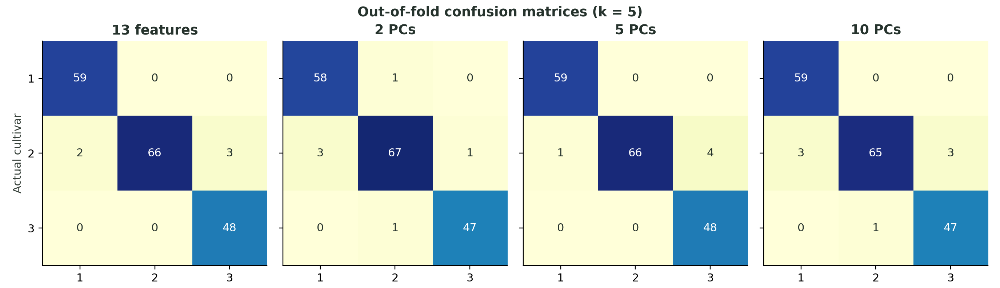
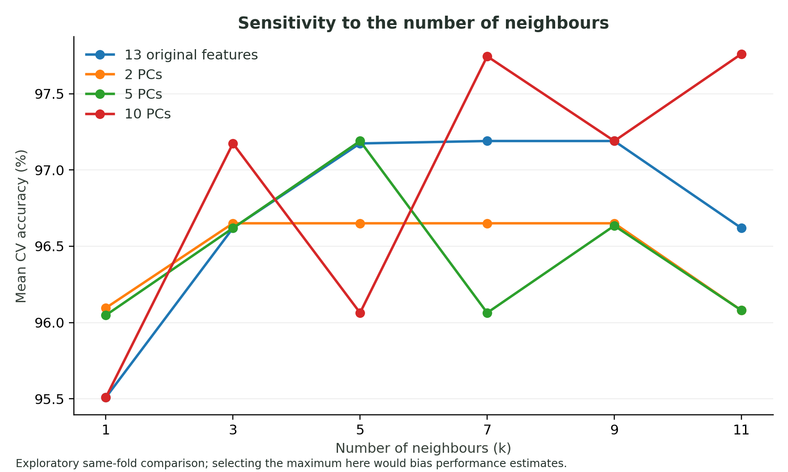
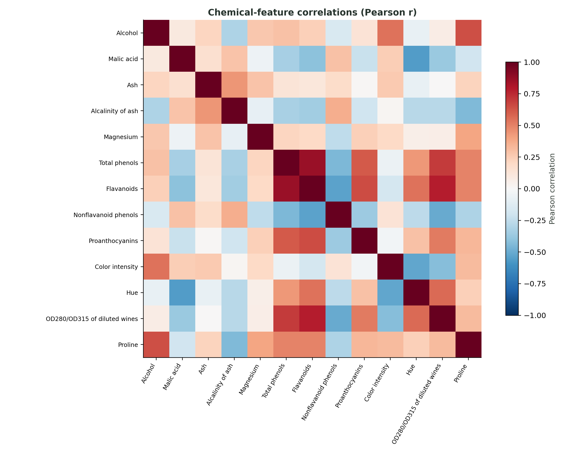

# Principal components and wine classification

**A comparison of k-nearest neighbours with original chemical features and PCA**  
Pranav, Viren, and William

## Abstract

We investigate how principal component analysis (PCA) changes the accuracy of k-nearest neighbours (k-NN) when classifying wine cultivars. The UCI Wine dataset contains 178 samples, 13 chemical measurements, and three classes. We compare a baseline using all 13 standardised features with models using 2, 5, and 10 principal components. Each model uses five neighbours and the same shuffled, stratified five-fold split; scaling and PCA are fitted only on each training fold. Mean accuracy is 97.17% for the baseline, 96.65% with two components, 97.19% with five components, and 96.06% with ten components. The baseline and five-component model both classify 173 of 178 samples correctly in their pooled out-of-fold predictions. Five components therefore provide a substantial reduction in dimension with similar observed accuracy, rather than evidence of a predictive improvement. Accuracy does not increase monotonically with the number of retained components. An exploratory neighbour-count sweep and a separately nested tuning experiment examine the sensitivity of this result.

## 1. Introduction

Our research question is: **How does classification accuracy change when k-NN uses principal components instead of all the original features to classify wine varieties?** This follows the comparison set out in the [project proposal](../project_proposal).

k-NN assigns a class using nearby training samples. Because the chemical measurements have different scales, using raw Euclidean distances would allow features with larger numerical ranges to dominate. We therefore standardise each feature before fitting k-NN.

PCA creates orthogonal directions that explain variation in the standardised data. Retaining a subset of these directions reduces the number of coordinates used to calculate distances. This could remove redundant information, but it could also discard useful class information: PCA uses variation in the features, not the class labels, to choose its directions. We test the proposed component counts of 2, 5, and 10 while keeping the classifier and evaluation splits consistent.

## 2. Data and exploration

The data are the UCI Wine dataset, acquired through the copy distributed with `sklearn.datasets.load_wine`. The committed [CSV](../data/wine.csv) makes the observations available without a subsequent network download. The source dataset consists of chemical measurements of wines from the same region of Italy, derived from three different cultivars. The target identifies a cultivar class; it is not a wine-quality score. UCI does not provide cultivar names, so we use Class 1, Class 2, and Class 3. [1, 2]

| Check | Result |
| --- | --- |
| Feature matrix | 178 samples × 13 numeric features |
| Target | 178 class labels |
| Number of classes | 3 |
| Class 1 | 59 samples |
| Class 2 | 71 samples |
| Class 3 | 48 samples |
| Missing feature values | 0 |
| Licence | Creative Commons Attribution 4.0 International |

The 13 features are alcohol, malic acid, ash, alcalinity of ash, magnesium, total phenols, flavanoids, nonflavanoid phenols, proanthocyanins, colour intensity, hue, OD280/OD315 of diluted wines, and proline. The CSV also includes sample identifiers and class labels; these are metadata and are excluded from the feature matrix. [Data documentation](../data/README.md) records the provenance and label mapping.

For exploration, we fit a separate scaler and PCA on the complete feature matrix. The first two components explain 55.41% of the standardised feature variance; the first five explain 80.16%, and the first ten explain 96.17%. The two-dimensional plot helps describe class structure and overlap. These full-data transformations are used only for descriptive figures, loadings, and variance summaries. They are never reused to evaluate a classifier.

*Figure 1. Full-data PCA projection for exploration. This visualisation is separate from the fold-specific PCA models used for validation.*

*Figure 2. Retained variance describes the features, rather than directly measuring classification performance.*

## 3. Methods

### 3.1 Matched classification pipelines

The baseline is `StandardScaler → k-NN`. Each reduced model is `StandardScaler → PCA → k-NN`. Standardisation subtracts the training mean and divides by the training standard deviation. PCA operates on these standardised features without whitening. The classifier uses five neighbours, uniform voting weights, and Euclidean distance. The component counts are fixed in advance at 2, 5, and 10, following the proposal.

We use scikit-learn pipelines so that scaling and PCA are refitted inside each training fold. Validation observations are transformed using only the quantities learned from that fold's training data. Fitting either transformation to the complete dataset before cross-validation would allow information from validation observations into model preparation. [3]

### 3.2 Cross-validation and reported quantities

We use five-fold stratified cross-validation with shuffling and random seed 42. All models receive the same training and validation indices. Three validation folds contain 36 samples and two contain 35; each observation is evaluated once, after training on the other four folds.

Our primary summary is the arithmetic mean of the five validation accuracies. We report the sample standard deviation across those five scores, using a denominator of four. This describes fold-to-fold variability; it is not a standard error or a confidence interval. The folds share training observations, so their scores are dependent.

For a direct comparison, we subtract each baseline fold's accuracy from the accuracy on the same fold for each PCA model. The mean of these paired differences is reported in percentage points. We also pool the held-out predictions to calculate an out-of-fold accuracy, a confusion matrix, and per-class precision, recall, and F1. Pooled accuracy weights each observation equally, whereas mean fold accuracy weights each fold equally.

No separate external test set is used. The fixed-k results describe this specified cross-validation experiment and should not be interpreted as a guarantee of performance on new wine collections.

### 3.3 Neighbour-count sensitivity and tuning

The main comparison keeps the neighbour count fixed at five. We additionally evaluate neighbour counts 1, 3, 5, 7, 9, and 11 on the same outer splits for each representation. This sweep is exploratory. Selecting whichever result looks best on these validation folds and reporting it as an independently evaluated tuned model would be optimistic.

We therefore run a separate nested cross-validation experiment for neighbour-count selection. Each of the five outer training sets contains an inner, stratified three-fold search over the same six neighbour counts. Scaling and PCA are fitted inside the search pipelines. After selection, the pipeline is refitted on the complete outer training set and scored once on its held-out outer fold. The representation is fixed separately for each nested experiment; this procedure selects the neighbour count, not the number of principal components. [4]

The inner split seed is 42 plus the outer fold number. When neighbour counts tie on the inner mean accuracy, the search selects the smallest tied count, following its ascending parameter order.

## 4. Main results

As a basic reference, a classifier that always predicts the most frequent training class reaches a mean accuracy of 39.90% on the same folds. The main baseline below uses all 13 chemical features with k-NN.

| Representation | Coordinates used | Mean accuracy | Sample SD | Difference from baseline |
| --- | ---: | ---: | ---: | ---: |
| Original features | 13 | 97.17% | 2.02 pp | 0.00 pp |
| PCA | 2 | 96.65% | 2.32 pp | −0.52 pp |
| PCA | 5 | 97.19% | 1.96 pp | +0.02 pp |
| PCA | 10 | 96.06% | 1.55 pp | −1.11 pp |

*Figure 3. The main comparison keeps the neighbour count fixed at five. Variability is the sample standard deviation across the matched folds.*

The table reports a fixed neighbour count of five. The standard deviation is measured in percentage points (pp). The apparent advantage of the five-component model is only 0.0159 percentage points before rounding. Both that model and the original-feature baseline correctly classify 173 of 178 out-of-fold observations, giving a pooled accuracy of 97.19%. Their tiny difference in mean fold accuracy arises because the mistakes are distributed differently between folds of 35 and 36 samples. It does not correspond to one model getting more samples correct overall.

The two-component model correctly classifies 172 of 178 observations, while the ten-component model correctly classifies 171. Out-of-fold predictions are made by five fitted models, each evaluated only on its held-out fold; they are not in-sample predictions from one model trained on all 178 observations.

For both the baseline and five-component model, all five errors concern samples from Class 2. Their Class 2 recall is 66/71, or 92.96%, while their recalls for Classes 1 and 3 are 100% in this experiment. The baseline assigns two of those Class 2 samples to Class 1 and three to Class 3; the five-component model assigns one to Class 1 and four to Class 3. Matching total accuracy therefore does not mean the classifiers make identical predictions.

*Figure 4. Counts pool predictions made only when each observation was held out. Rows identify true classes and columns identify predicted classes.*

Using five principal components reduces the distance calculation from 13 coordinates to five, a reduction of 61.5%, while retaining similar observed accuracy. This is a reduction in feature-space dimension; the experiment does not establish an end-to-end speedup, because fitting and applying PCA also have a computational cost.

The [machine-readable results](../results/analysis.json) include the unrounded fold scores, paired differences, confusion matrices, and class metrics. The [dashboard](../dashboard/index.html) provides an interactive comparison and a view of the underlying observations.

## 5. Sensitivity and tuning results

The exploratory sweep gives the following mean accuracies on the shared outer folds:

| Neighbours | Original features | PCA, 2 components | PCA, 5 components | PCA, 10 components |
| ---: | ---: | ---: | ---: | ---: |
| 1 | 95.51% | 96.10% | 96.05% | 95.51% |
| 3 | 96.62% | 96.65% | 96.62% | 97.17% |
| 5 | 97.17% | 96.65% | 97.19% | 96.06% |
| 7 | 97.19% | 96.65% | 96.06% | 97.75% |
| 9 | 97.19% | 96.65% | 96.63% | 97.19% |
| 11 | 96.62% | 96.08% | 96.08% | 97.76% |

*Figure 5. The sweep is descriptive. Choosing the highest point after seeing these scores would use the validation folds for selection.*

The ordering depends on the neighbour count. At five neighbours, the five-component model is close to the baseline; at seven or eleven neighbours, the ten-component model has higher observed accuracy. The five-component result should therefore be read as a finding under the fixed classifier setting, not as a universally best representation.

The separately nested experiment evaluates selecting a neighbour count using only each outer training set:

| Representation | Nested mean accuracy | Sample SD | Selected neighbours, outer folds 1–5 |
| --- | ---: | ---: | --- |
| Original features | 97.75% | 2.38 pp | 5, 11, 5, 1, 11 |
| PCA, 2 components | 96.65% | 2.32 pp | 3, 3, 7, 3, 3 |
| PCA, 5 components | 96.05% | 2.54 pp | 3, 9, 11, 11, 3 |
| PCA, 10 components | 97.75% | 2.38 pp | 5, 3, 9, 9, 11 |

The baseline and ten-component representation tie in nested mean accuracy. The five-component representation scores lower than in the fixed-k experiment, illustrating that tuning does not guarantee an improvement on unseen folds. Selected neighbour counts differ between outer folds because each search sees a different training subset.

These outputs answer different questions. A high point on the sweep is a candidate setting seen during exploration. A nested score evaluates a specified tuning procedure on outer observations that were not used for that selection. Neither replaces the fixed-k comparison that isolates the effect of the proposed component counts. Full sweep variability and nested fold results are in [analysis.json](../results/analysis.json) and the [CSV exports](../results/).

## 6. Discussion and limitations

The observed results support PCA as a way to compress the representation while maintaining high accuracy on this dataset. At a fixed neighbour count of five, five components perform similarly to the original 13 features, and even two components retain a high classification accuracy. The sensitivity and nested experiments show that the ranking changes with the classifier setting. Retaining more variance does not always improve classification: ten components retain more feature variance than five, yet have lower measured accuracy in the fixed-k experiment. Variance explains the geometry of the measurements; it does not by itself identify the most useful geometry for class separation.

The dataset is small. One incorrect prediction changes pooled accuracy by approximately 0.56 percentage points, which exceeds the mean accuracy gap between the baseline and five-component model. Validation folds have only 35 or 36 observations, so moving one mistake between folds also changes the fold summaries noticeably.

We use one seeded outer partition. A different partition could alter the ordering of these closely performing models. The reported standard deviations describe those five folds and do not establish a statistically significant difference. Repeated, matched cross-validation would help assess sensitivity to partition choice; external samples would be needed to assess generalisation to other wine collections.

The comparison is limited to one dataset, uniform-weight Euclidean k-NN, and the specified representations. It does not establish that five components are universally optimal. Inspecting multiple component counts and neighbour counts also introduces opportunities for selection effects. The nested experiment handles neighbour-count tuning within each representation, but comparing the representations after seeing their outer scores remains a descriptive comparison.

Finally, a full-data PCA scatter plot can make classes appear visually separated without proving held-out predictive performance. We keep that descriptive plot separate from the fold-specific transformations used for evaluation.

The feature correlations help motivate reducing dimension: total phenols and flavanoids have a Pearson correlation of 0.865 in this dataset. This indicates shared variation, but a correlation between measurements does not prove that either can be discarded without affecting a classifier.

*Figure 6. Full-data feature correlations are descriptive and do not enter validation preprocessing.*

## 7. Conclusion

For this matched five-fold experiment, replacing 13 standardised features with five principal components preserves the observed performance of k-NN: the two models make the same number of correct out-of-fold predictions. Two components produce slightly lower accuracy, and ten components do not improve the result. PCA can therefore provide a smaller representation with a modest or negligible accuracy cost here, but the results do not demonstrate that PCA improves accuracy or that more retained components always help. Repeated partitions and an independent dataset would be useful next checks.

## Reproducibility

The repository includes the acquired data, Python analysis, pinned dependencies, result tables, figures, and a static dashboard. Run `python3 -m src.analysis` from the repository root after installing [requirements.txt](../requirements.txt) to regenerate the outputs. The recorded environment uses Python 3.10.12 and scikit-learn 1.7.2; exact library versions are also saved in `results/analysis.json`. CSV exports include fold scores, out-of-fold predictions, model comparisons, class metrics, PCA summaries, and tuning results. Every report figure is available in both PNG and SVG format.

The original [proposal](../project_proposal) and [early-draft guidelines](../early_draft_guidlines) are preserved. The [early draft](early_draft.md) records the acquired-data and baseline checkpoint, and the [paper outline](paper_outline.md) maps the report section by section. Follow the commands in the [repository README](../README.md) to run the checks or serve the dashboard locally.

## References

1. Aeberhard, S., & Forina, M. (1992). *Wine* [Dataset]. UCI Machine Learning Repository. [Dataset and licence](https://archive.ics.uci.edu/dataset/109/wine). DOI: [10.24432/C5PC7J](https://doi.org/10.24432/C5PC7J). Licensed under [CC BY 4.0](https://creativecommons.org/licenses/by/4.0/).
2. scikit-learn documentation. [`load_wine`](https://scikit-learn.org/1.7/modules/generated/sklearn.datasets.load_wine.html).
3. scikit-learn documentation. [Common pitfalls and recommended practices](https://scikit-learn.org/1.7/common_pitfalls.html).
4. scikit-learn documentation. [Nested versus non-nested cross-validation](https://scikit-learn.org/1.7/auto_examples/model_selection/plot_nested_cross_validation_iris.html).
